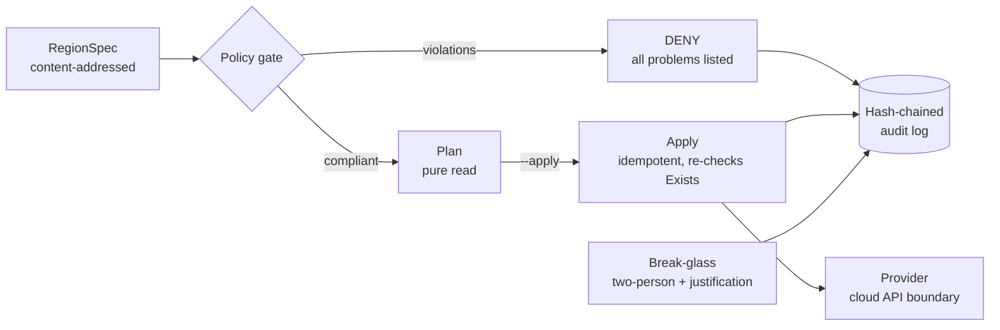

# regionctl — Secure Region Control Plane

**A Go control plane that turns a declarative region spec into provisioned infrastructure — refusing non-compliant specs before anything is touched, converging idempotently, and recording every decision in a tamper-evident audit log.**

Standing up an isolated environment for sensitive workloads is mostly about what you *don't* let happen: a public egress route in an air-gapped region, an unencrypted service, a half-finished bootstrap after a crash, a privileged change nobody can account for. `regionctl` models that control plane with a policy gate, a plan/apply reconciler, two-person break-glass, and a hash-chained audit trail.



## Highlights

- **Policy before provisioning.** `policy.Evaluate` runs every rule and returns *all* violations at once — no public egress in isolated regions, every service encrypted, an `owner` tag required — so an operator fixes everything in one pass.
- **Plan/apply split.** `Plan` computes the gap between the spec and the provider without side effects; `Apply` only runs when explicitly requested.
- **Crash-safe convergence.** Providers must be idempotent and `Apply` re-checks `Exists` before each create. A chaos test crashes the control plane on the third of four creates, restarts, and proves the region converges with exactly four resources and no duplicates.
- **Content-addressed specs.** Each `RegionSpec` is named by the SHA-256 of its canonical JSON, so audit entries reference *what* was applied, not just when.
- **Tamper-evident audit.** Each log entry commits to the previous entry's hash; `Verify()` returns the index of the first altered or relinked entry.
- **Break-glass with a paper trail.** Privileged actions require an approver distinct from the requester and a justification, and are audited *before* the privilege is granted.

## Quick start

Requires Go 1.22+. No external dependencies.

```bash
git clone https://github.com/AliAzamat/secure-region-control-plane.git
cd secure-region-control-plane

go test ./...            # audit tamper detection, idempotent apply, mid-apply crash drill
go run ./cmd/regionctl   # loads a sample spec and prints its content address
```

## What the pipeline does

`Bootstrap` in `cmd/regionctl/cli.go` chains the gate, plan, and apply stages. Real output for a non-compliant spec, then a compliant one:

```text
$ # isolated region, public egress on 10.0.0.0/16, unencrypted "logs", no owner tag
DENY [no-public-egress-when-isolated] network 10.0.0.0/16 has public egress in an isolated region
DENY [all-services-encrypted] service logs is not encrypted
DENY [require-owner-tag] spec is missing an 'owner' tag
# exit code 2

$ # compliant spec, plan-only
plan: 2 change(s) for region au-sensitive-1
  + network 10.0.0.0/16 (network absent)
  + service kms (service absent)
(plan-only; re-run with --apply to converge)

$ # apply, then apply again
applied 2 change(s)
plan: 0 change(s) for region au-sensitive-1
applied 0 change(s)
```

Exit codes: `0` success, `2` policy denied, `1` operational error.

## Project layout

| Package | Responsibility |
|---|---|
| `internal/spec` | `RegionSpec` (networks, services, tags) and its SHA-256 content address |
| `internal/policy` | Rule functions and `Evaluate`, which collects every violation |
| `internal/reconcile` | `Provider` interface, side-effect-free `Plan`, idempotent `Apply`, chaos test |
| `internal/audit` | Append-only, hash-chained log with `Verify` |
| `internal/breakglass` | Two-person, justified, audited authorization |
| `cmd/regionctl` | Entry point and the `Bootstrap` gate → plan → apply pipeline |

## Status and limitations

A working model of control-plane safety properties, not a provisioning tool.

- The only `Provider` is an in-memory fake used by tests; nothing talks to a cloud API.
- `main.go` loads a hard-coded sample spec. `Bootstrap` is implemented but not yet exposed through command-line flags, so the `--apply` hint in its output refers to a flag that doesn't exist yet.
- The audit log is in-memory; there's no persistent or versioned spec store.
- Policy and break-glass packages have no dedicated tests yet.
- The Go module path is `github.com/khwajalabs/regionctl`; build from a clone rather than with `go install`.
